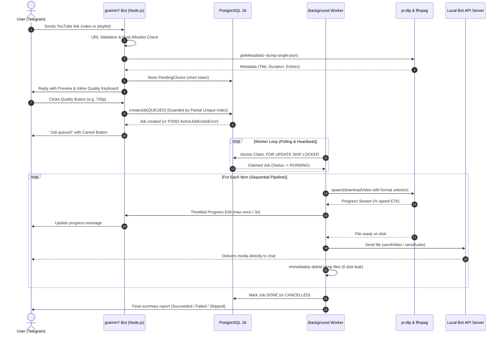
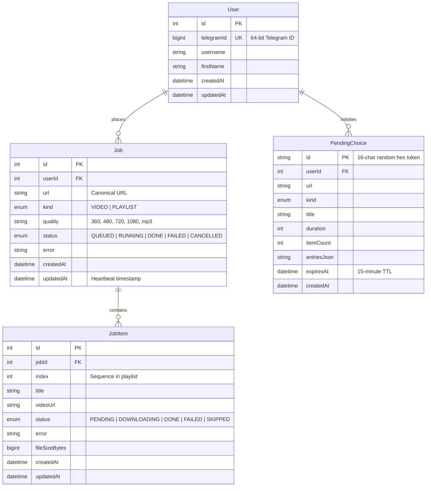

# 🎬 YouTube Downloader Telegram Bot

A production-grade, self-hosted personal Telegram bot that downloads YouTube videos and full playlists with interactive quality selection (360p, 480p, 720p, 1080p, Audio MP3), backed by PostgreSQL 16 and a local Telegram Bot API server.

---

## ⚖️ Legal Disclaimer & Terms of Use

> [!IMPORTANT]
> **Educational and Personal Use Only:** This software is designed strictly for educational exploration, network protocol study, and personal archival backups of content you own or have explicit legal authorization to download. 
> 
> The bot contains **no circumvention tools for digital rights management (DRM)** and relies solely on standard format streaming APIs exposed to client browsers. The operator of this bot assumes full legal responsibility for compliance with YouTube's Terms of Service, applicable copyright legislation, and intellectual property rights.

---

## 🧭 What This Project Is and Isn't

### What It Is
- **Personal & Hardened:** Secured via user allowlisting (`ALLOWED_USER_IDS`), strict URL parsing, and input sanitation.
- **Fault-Tolerant:** Playlist processing with per-item error boundaries; one unavailable video does not abort a 25-video playlist.
- **Resource Safe:** Strictly limits storage exposure to $O(1)$ disk space per job (sequential download $\rightarrow$ send $\rightarrow$ delete lifecycle).
- **Concurrent & Coordinated:** Powered by PostgreSQL transactions (`FOR UPDATE SKIP LOCKED`) and partial unique indexes to guarantee at most one active job per user.

### What It Isn't
- **Not a Public Multi-Tenant SaaS:** Designed for single-operator or private family/team usage.
- **Not a High-Throughput Scraper:** Does not circumvent YouTube's bot detection or proof-of-work challenges.
- **Not a DRM Decryption Tool:** Encrypted / Widevine protected streams are rejected.

---

## 🚀 One-Command Quickstart

Ensure you have [Docker](https://www.docker.com/) and [Docker Compose](https://docs.docker.com/compose/) installed, then:

```bash
# 1. Clone the repository
git clone https://github.com/your-username/youtube-downloader-bot.git
cd youtube-downloader-bot

# 2. Copy the environment template
cp .env.example .env

# 3. Configure your credentials in .env (see Credentials section below)
nano .env

# 4. Launch the entire system with one command
docker compose up -d
```

---

## 🔑 Obtaining Telegram Credentials

To run the bot with full 2GB upload capabilities, you need two sets of credentials:

### 1. Bot Token (from BotFather)
1. Open Telegram and search for [@BotFather](https://t.me/BotFather).
2. Send `/newbot` and follow the prompts to choose a name and username.
3. BotFather will provide an HTTP API token (e.g., `123456789:ABCdefGhIJKlmNoPQRsTUVwxyZ`).
4. Paste this into your `.env` as `BOT_TOKEN`.

### 2. Telegram API ID & Hash (from my.telegram.org)
1. Log in to [my.telegram.org](https://my.telegram.org) using your Telegram phone number.
2. Navigate to **API development tools**.
3. Create a new application (app title and short name can be anything, e.g. `MyPersonalDownloader`).
4. Copy the numeric **api_id** and the hex **api_hash**.
5. Paste them into `.env` as `TELEGRAM_API_ID` and `TELEGRAM_API_HASH`.

### 3. Your Numeric Telegram User ID
1. Message [@userinfobot](https://t.me/userinfobot) or [@raw_data_bot](https://t.me/raw_data_bot) in Telegram to find your numeric ID (e.g. `987654321`).
2. Add your ID to `.env` under `ALLOWED_USER_IDS=987654321`. Anyone not on this list will be rejected by the allowlist middleware.

---

## 📦 The 50 MB vs 2 GB Upload Limit

By default, Telegram bots communicating with `https://api.telegram.org` are subject to a **50 MB file upload limit**. Higher-quality 1080p videos or hour-long podcasts routinely exceed this threshold.

```
Standard Telegram Cloud API: ──▶ Limited to 50 MB uploads
Local telegram-bot-api Server: ─▶ Unlocks 2,000 MB (2 GB) uploads
```

This project includes a self-hosted `aiogram/telegram-bot-api` service in `docker-compose.yml`. The local server interfaces directly with Telegram's internal MTProto protocol, raising the upload ceiling to **2 GB**. The bot automatically transmits media directly to the local server, which streams it to Telegram's cloud storage.

---

## ⚙️ System Architecture

### Sequence Diagram: Flow of a Download Job



### Entity-Relationship Diagram



---

## 🛠️ Bot Commands

| Command | Description |
| :--- | :--- |
| `/start` | Displays welcome message, allowed limits, and usage instructions in Arabic. |
| `/status` | Shows details of your currently running or queued job, including playlist progress and an inline Cancel button. |
| `/cancel` | Immediately requests cancellation of your active job and frees your queue slot. |

---

## 🔄 Updating `yt-dlp`

YouTube continuously rolls out changes to its video player and bot-detection heuristics. Keeping `yt-dlp` updated is mandatory.

### Pinned Image Version
The base Dockerfile pins a known-working version:
```dockerfile
ARG YTDLP_VERSION=2025.02.19
```

### One-Command In-Container Update
To update `yt-dlp` inside the live running container without recreating the database:
```bash
docker compose exec bot yt-dlp -U
```

### Local Development Update
```bash
npm run update:ytdlp
```

---

## 🍪 Optional Cookies Support (Bot Verification Bypass)

Datacenter IP addresses (e.g. AWS, Hetzner, DigitalOcean) are frequently challenged by YouTube with:
`"Sign in to confirm you're not a bot"`.

If you encounter this error, configure a Netscape-formatted `cookies.txt` file:

1. Install a browser extension like *Get cookies.txt LOCALLY* in an incognito window.
2. Sign in using a **disposable/throwaway Google account** (never your personal main account).
3. Export cookies for `youtube.com` into a file named `cookies.txt`.
4. Place `cookies.txt` in the project root (it is automatically ignored by `.gitignore`).
5. In `.env`, set:
   ```env
   COOKIES_PATH=./cookies.txt
   ```
6. In `docker-compose.yml`, uncomment the volume mount:
   ```yaml
   volumes:
     - ./cookies.txt:/app/cookies.txt:ro
   ```

> [!WARNING]
> **Account Safety:** Never use your primary personal Google account for automated tools. If YouTube flags high-frequency automated downloads, the associated Google account risks suspension. Always use a dedicated burner account.

---

## ⚠️ Known Limitations

1. **Datacenter IP Throttling:** Cloud providers (Hetzner, OVH, AWS) are often flagged by Google. If running on a cloud VPS, you will likely need residential proxy chaining or a cookies file. Running on a home server (e.g. Raspberry Pi) usually experiences zero bot challenges.
2. **YouTube Player Algorithm Changes:** If downloads suddenly fail across all links with `JSON_PARSE_ERROR` or signature extract errors, update `yt-dlp` immediately.
3. **Telegram 2GB Ceiling:** Individual video files cannot exceed 2000 MB. If a requested 1080p video exceeds 2GB, the bot notifies the user and offers a lower quality option.

---

## 💡 Trade-offs and Lessons Learned

*The following notes reflect architectural decisions and real-world bugs encountered during implementation:*

1. **PostgreSQL Default Windows Encoding (`WIN1252` vs `UTF8`):**
   - *Problem:* When developing on Windows, PostgreSQL defaults new databases to the Windows system code page (`WIN1252`). When Prisma generated error messages containing Unicode arrows (`→`) or when Arabic characters were inserted, Postgres threw error code `22P05` (`character with byte sequence ... in encoding WIN1252 has no equivalent in UTF8`).
   - *Fix:* Automated the database setup to initialize explicitly from `template0` with `ENCODING 'UTF8'`.
2. **Parallel Test State Collisions in Jest:**
   - *Problem:* Jest executes test suites in parallel worker threads. Tests calling `prisma.job.deleteMany()` inside `beforeEach` wiped out active rows created simultaneously by concurrency or playlist tests running in another worker thread.
   - *Fix:* Scoped test fixtures by user ID partitions (e.g. users `654321`, `700000`, `888123`) so test suites can run in parallel without touching each other's data.
3. **Telegram 64-Byte Callback Limit:**
   - *Problem:* Storing target URLs or video IDs directly inside Telegram inline keyboard `callback_data` fails because Telegram enforces a strict 64-byte payload limit. Long playlist URLs easily exceed 100 bytes.
   - *Fix:* Implemented `PendingChoice` with a 16-character hexadecimal token (`q:<token>:<quality>`), taking under 26 bytes total.
4. **Process Tree Termination Across Operating Systems:**
   - *Problem:* Calling `child.kill('SIGKILL')` on Node.js on Windows terminates the parent `yt-dlp` executable but leaves spawned child processes (`ffmpeg.exe`) orphaned in the background, locking files and leaking CPU.
   - *Fix:* Built `killProcessTree` that detects OS platform: executing `taskkill /pid <pid> /T /F` on Windows to kill the entire process tree, and `process.kill(-pid, 'SIGKILL')` via process groups on Linux.
5. **Zero Disk Accumulation in Playlist Processing:**
   - *Problem:* A 25-video playlist can easily exceed 40 GB. Downloading the entire playlist before sending risks exhausting the host container's disk space.
   - *Fix:* Implemented a strict sequential pipeline: each item downloads into an isolated directory, is immediately uploaded to Telegram, and its directory is removed in a `finally` block before the next item begins. Disk consumption remains bounded at $O(1)$.
